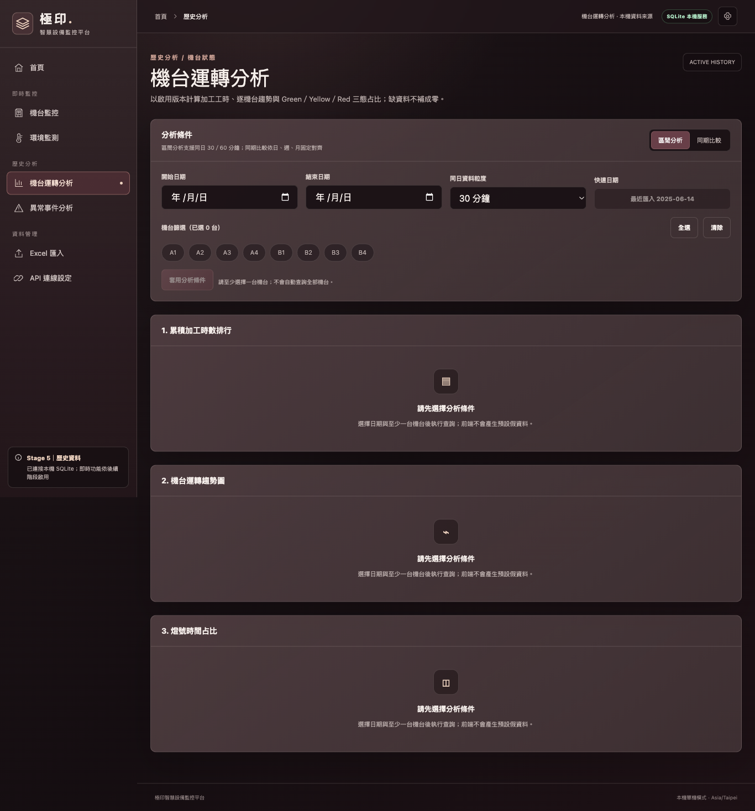
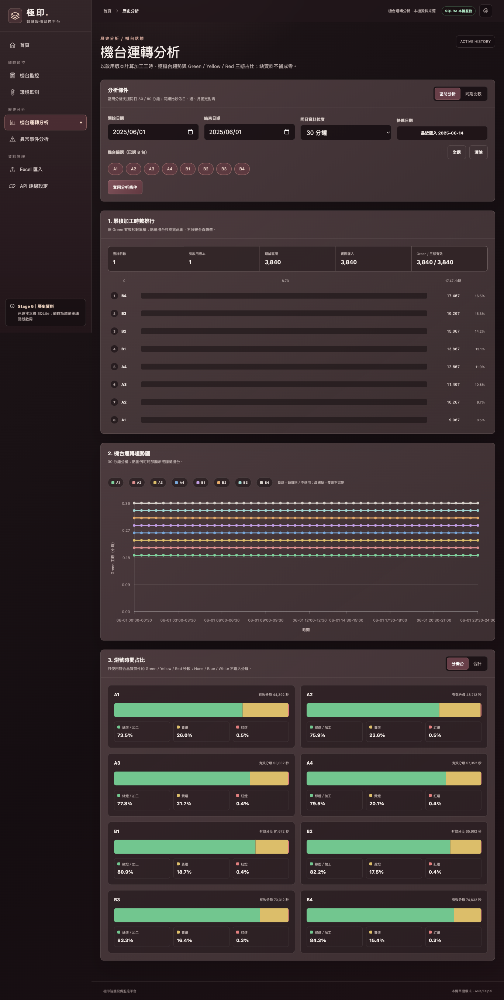
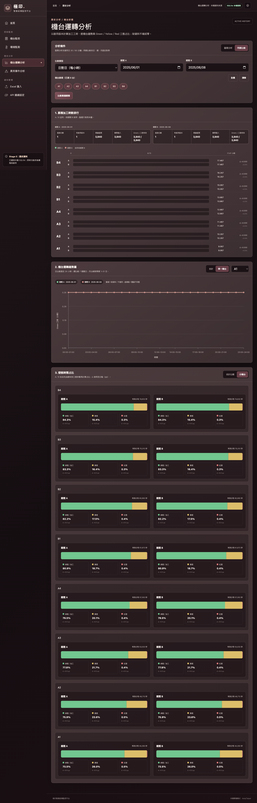

# Stage 5.3 Acceptance — Machine Operation Analysis V1.1

Date: 2026-11-15

Branch: `dev`

Implementation commit: `e759409`

Scope: the Machine Operation Analysis page, its read-only historical-processing contract, statistic eligibility, synthetic tests, and browser acceptance only. Excel import/version behavior was preserved. No enterprise API, private workbook, Stage 6/7 implementation, deployment, push, database deletion, or Docker-volume deletion occurred.

## Decision

Stage 5.3 is accepted for program implementation, automated tests, public synthetic data, and desktop-browser validation. The page is now formally named **機台運轉分析**, starts with no selected machine, supports range and day/week/month comparison modes, and renders the three approved charts in the required order:

1. 累積加工時數排行
2. 機台運轉趨勢圖
3. 燈號時間占比

Enterprise/private-data acceptance is deliberately **not claimed**. All screenshots and browser measurements use the committed public synthetic seed.

## Delivered implementation

### M1 — Data contract and statistics

- Added a dedicated Green/Yellow/Red three-state calculation. Its denominator is the sum of eligible G/Y/R seconds only; None/Blue/White remain stored and available to the legacy six-state audit path but do not enter this chart.
- Three-state eligibility is independent from the old six-state percentage. Missing G/Y/R values, stale quality versions, `SOURCE_QUALITY_MISSING`, `QUALITY_STATUS_UNKNOWN`, and source-confirmed `STATE_SEVERE_INCOMPLETE` rows are excluded without rewriting source seconds.
- A zero three-state denominator returns null percentages and `MISSING_DATA`, not an invented 0%/100% bar.
- Range trend points now return expected/imported/eligible interval counts and `COMPLETE`, `PARTIAL`, or `MISSING` completeness. An incomplete machine aggregate cannot look complete.
- Day comparison is fixed at 24 one-hour positions. Week comparison accepts any starting date and returns seven relative days. Month comparison returns positions 1–31 and marks non-existent dates `NOT_APPLICABLE`.
- Monthly ranking uses total Green hours divided by the full number of calendar days. An unfinished month is flagged `partial` with elapsed/calendar-day metadata without changing that denominator.
- Comparison ranking returns backend-calculated absolute difference and relative change. A zero A baseline keeps the absolute difference and returns null relative change.
- Comparison three-state results return backend-calculated percentage-point deltas and per-machine rows sorted by period-B Green share.

Evidence: `src/server/statistics/history-statistics.ts`, `src/server/statistics/history-service.ts`, `tests/statistics.test.ts`, and `tests/history-service.test.ts`.

### M2 — Filters and analysis modes

- Navigation, page heading, home entry copy, and browser breadcrumb now use **機台運轉分析**.
- The initial machine selection is empty. The processing API rejects a missing/empty `machineIds` parameter instead of silently querying all machines.
- Changing between range and comparison modes clears the selected machines, previous result, chart highlights, hidden legends, and local chart modes.
- Range mode supports same-day 30/60-minute grain and automatically uses daily points for a multi-day range.
- Comparison mode exposes day/week/month periods without an irrelevant bucket control.
- Chart-local highlighting, legend visibility, overall/single trend mode, and machine/overall share mode do not mutate the page-level machine filter or trigger a new database query.

Evidence: `src/app/history/processing/page.tsx`, `src/app/api/history/processing/route.ts`, `src/components/app-shell.tsx`, `src/app/page.tsx`, and `tests/stage53-page-shell.test.tsx`.

### M3 — Three formal charts

- Ranking uses a horizontal numeric axis, value/share columns, period A/B grouped bars in comparison mode, period-B sorting, absolute/relative deltas, and local click highlighting that can be cancelled.
- Trend uses a real SVG plot with X/Y axes, units, ticks, multiple distinguishable series, keyboard-focusable data points, SVG tooltip titles, missing-data line breaks, and partial-coverage point styling.
- Range trend legend buttons independently show/hide machine series. Comparison trend switches between aggregate and one selected machine while retaining two fixed A/B lines.
- Light-state share uses only backend G/Y/R percentages. Range mode switches between per-machine and aggregate cards. Comparison mode switches between aggregate and per-machine A/B cards and displays backend percentage-point differences.
- The three panels are full width, ordered as approved, and separated by a parent-controlled 24px gap. The burgundy/deep-purple product language and existing shared components are retained.

Evidence: `src/components/history-widgets.tsx`, `src/app/history/processing/page.tsx`, and `src/app/globals.css`.

## API compatibility

The existing `GET /api/history/processing` route and legacy aggregate fields remain. Additions are read-only and backward compatible except for one intentional V1.1 safety change: `machineIds` is now required so an empty selection cannot query all machines implicitly.

- Range additions: `period`, point-level `coverage`, `selectedGreenShare`, `threeStateShare`, and `threeStateShareByMachine`.
- Comparison additions: partial-period metadata, `totalGreenHours`, `unit`, `difference`, `relativeChange`, `seriesByMachine`, `threeStateShare`, `threeStateShareByMachine`, and `deltaPercentagePoints`.
- Existing `stateShare` and `stateShareByMachine` six-state fields remain for compatibility/audit consumers. The Stage 5.3 chart does not use them.
- Active Batch selection still comes from the existing active-history repository. No cache or client-side business calculation was introduced.

## H01–H20 reproducible acceptance

| ID | Fixed input and expected result | Actual result and evidence |
|---|---|---|
| H01 | Open the page with no machines. Query must remain disabled and all three panels must request a selection. | Passed. Browser measured `selected=0`, disabled query, and three identical prompts. Route regression returns HTTP 400 without `machineIds`; page-shell test verifies chart order. |
| H02 | 2025-06-01, A1/A2/B4, 30m. Expect three ranks, 3×48 theoretical points, and three share cards. | Passed. Browser produced three rank rows, three legends, 144 SVG points, and three G/Y/R cards. Values were B4 17.467h, A2 10.267h, A1 9.067h from the synthetic full-day rows. |
| H03 | Change H02 to 60m. Totals and shares must not change; trend becomes 3×24 points. | Passed. Browser changed 144 to 72 points. The three ranking totals and all nine state percentages were byte-for-byte equal before/after. |
| H04 | Import A1 on 2025-06-01 and 2025-06-03 only; query 06-01…06-03. | Passed. Service test returns `.05`, `null/MISSING_DATA`, `.025` on the three real date labels; the missing 06-02 point is not zero. |
| H05 | Highlight then cancel B4; toggle one trend legend. Other charts and page selection must remain unchanged. | Passed. Real Chrome measured one highlight then zero after the second click. Hiding one of eight series reduced points 384→336 while eight selected machines and eight share cards remained. |
| H06 | Switch range share between per-machine and aggregate. | Passed. Browser changed three cards to one aggregate card while ranking values and selected machines stayed unchanged. Aggregate is returned by the backend after summing seconds, not averaged in the UI. |
| H07 | Switch range→comparison. | Passed. Browser cleared all three machine selections, removed old result rows, showed A/B controls, and restored three empty chart prompts. |
| H08 | Day comparison 2025-06-01 vs 2025-06-08, A1/A2. | Passed. Browser rendered two grouped ranks and 48 SVG points (two lines × 24 hours); tooltip titles contained the real A/B dates. Aggregate/single-machine switching retained two lines and did not change the global two-machine selection. |
| H09 | Week comparison starting 2025-06-02 and 2025-06-08 (not constrained to Monday). | Passed. Browser accepted both dates, returned relative positions 1–7, and rendered 14 A/B points. |
| H10 | Month comparison 2025-02 (28 days) vs 2025-03 (31 days). | Passed. Service test verifies `.05/28` and `.025/31` hours/day plus expected intervals 26,880/29,760 for two machines. Position 29 is `NOT_APPLICABLE` for February and a real March value, never zero. Browser axis unit was `小時／日`. |
| H11 | Compare an unfinished June at fixed now=2025-06-15. | Passed. Service returns period B `partial=true`, `elapsedCalendarDays=15`, `days=30`, while ranking remains total `.05/30`. The UI exposes the partial-month warning and both period coverages. |
| H12 | A1/A2 three-state comparison; switch aggregate/per-machine. | Passed. With A values 50%/100% Green and B values 100%/25%, service sorted B as A1 then A2 and returned A1 `+50 pp`. Browser with eight machines rendered 16 A/B share bars in B-Green order. |
| H13 | Reliable row Green=0, Yellow=180. | Passed. Service returns ranking/trend Green `0` with `AVAILABLE`; three-state denominator 180 and Green/Yellow/Red 0%/100%/0%. |
| H14 | Missing Green or one important G/Y/R state. | Passed. Pure tests keep Green eligibility and three-state eligibility independent; missing Green is not zero, and a missing three-state value produces `THREE_STATE_VALUE_MISSING`. |
| H15 | G/Y/R denominator zero while six-state source still contains other states. | Passed. Pure test returns all three shares null with denominator zero. The legacy six-state function remains separately testable; the UI renders an unavailable explanation instead of a fake bar. |
| H16 | Source-confirmed severe 2025-06-04 00:54-shaped row. | Passed. Import regression preserves source values, adds `STATE_SEVERE_INCOMPLETE`, and disables affected metric eligibility. Three-state calculation excludes the row and the original 90/60/30 test seconds remain unchanged. |
| H17 | Aggregate hourly point contains A1 but not selected A2. | Passed. Service returns expected 40, imported 1, eligible 1, `PARTIAL`; A2 remains `MISSING_DATA`. SVG partial points have distinct styling and tooltip text. |
| H18 | Comparison A Green=0, B Green=.05h. | Passed. Backend returns absolute difference `.05` and null relative change; UI labels the growth rate as baseline-zero/missing rather than infinity. |
| H19 | Same-day Active Batch replacement `.05→.025`, then activate old batch. | Passed by route integration test. Each fresh processing request returns `.05`, then `.025`, then `.05`; all three charts use the same response and no client cache is retained. |
| H20 | 1366px/100%, eight machines. | Passed. Range rendered 8 ranks, 8 legend series, 384 points, and 8 share cards. Comparison rendered 8 grouped ranks, two 24-point lines in single-machine mode, and 16 A/B share bars. DOM measurements found no page or chart horizontal overflow at 1280, 1366, or 1440px. |

Synthetic full-day browser rows use 480 three-minute intervals per machine. Green is `60 + machineIndex×9 + (slot mod 5)×4`, Yellow is `20 + (slot mod 3)×4`, Red is 8 every seventeenth slot, and None is the traceable remainder to 180 seconds. The 2025-06-04 A1 00:54 row is explicitly source-marked severe with a 20-second total. The browser database contained 16 active dates and 61,440 machine intervals.

## Automated verification

| Command | Result |
|---|---|
| `npm run typecheck` | Passed |
| `npm run lint` | Passed with no warnings |
| `npm test -- --run` | Passed: 91 tests; one opt-in private-workbook suite skipped |
| `npm run build` | Passed with the project-approved `next build --webpack`; 18 routes emitted |
| `git diff --check` | Passed |
| tracked/untracked sensitive-data scan | Passed; no enterprise Excel/JSON, environment file, SQLite database, credential, internal endpoint, or `_reference_inputs` attachment is tracked |

High-value regressions are in `tests/statistics.test.ts`, `tests/history-service.test.ts`, `tests/stage5-route-flow.test.ts`, `tests/ui-view-models.test.tsx`, and `tests/stage53-page-shell.test.tsx`.

## Browser acceptance and screenshots

Environment: local production build, Chrome headless desktop at 100% scale, localhost:3000, disposable `/private/tmp` SQLite, and public synthetic history only. A separate in-app browser pass also exercised date fields, 30/60-minute switching, range aggregate shares, mode reset, day/week/month comparisons, and SVG tooltip titles.

The reproducible browser runner is `scripts/stage53-browser-acceptance.mjs`; the synthetic seed is `scripts/seed-stage53-browser.ts`.

### Empty state — 1366px

### Range mode — eight machines, 1366px

### Comparison mode — eight machines, 1366px

Measured layout results:

| Mode | Width | Viewport / scroll width | Main content width | Panel width | Chart overflow |
|---|---:|---:|---:|---:|---|
| Range | 1280 | 1280 / 1280 | 984 | 984 | No |
| Range | 1366 | 1366 / 1366 | 1070 | 1070 | No |
| Range | 1440 | 1440 / 1440 | 1144 | 1144 | No |
| Comparison | 1280 | 1280 / 1280 | 984 | 984 | No |
| Comparison | 1366 | 1366 / 1366 | 1070 | 1070 | No |
| Comparison | 1440 | 1440 / 1440 | 1144 | 1144 | No |

## Completion boundaries and known limits

- **Program implementation:** complete for Stage 5.3.
- **Automated test acceptance:** complete for repository and public synthetic fixtures.
- **Browser acceptance:** complete for empty, range, comparison, local interactions, eight-machine load, and 1280/1366/1440 desktop layout.
- **Real enterprise-data acceptance:** not performed and not claimed. The task forbids tracking or calling enterprise sources; the existing private-workbook opt-in suite remained skipped.
- The production-start command prints the repository's pre-existing standalone-output warning. The built server still served the acceptance run; formal container/production deployment remains a later authorized stage.
- The supplied final specification existed as `STAGE5_3_MACHINE_OPERATION_ANALYSIS_V1_1_FINAL_SPEC_WITH_REFERENCES.md`; it was used as V1.1 and preserved under that original name.

Stage 5.3 stops here. No Stage 6/7 work or push was performed.
