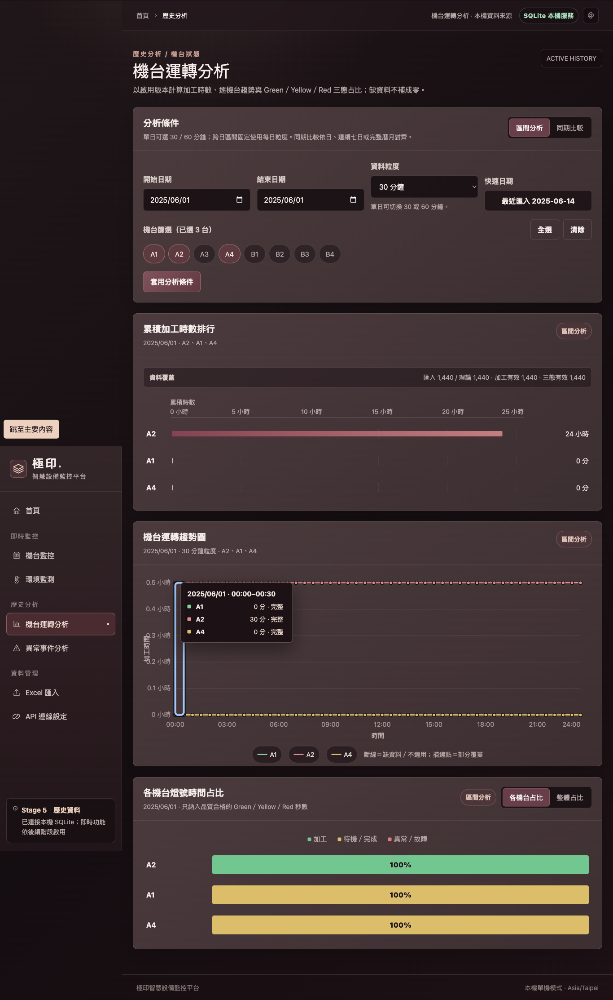
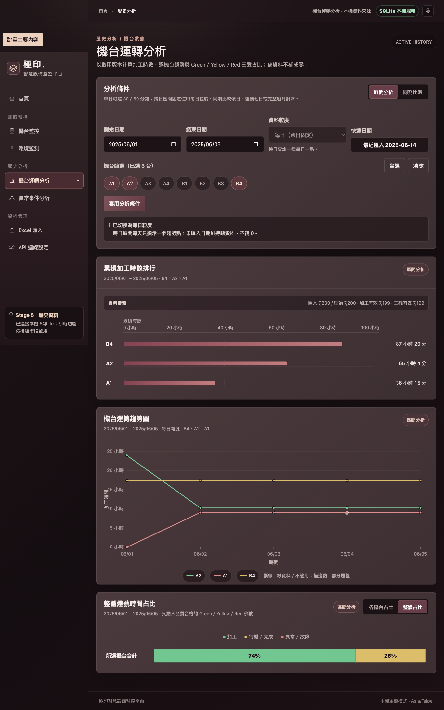
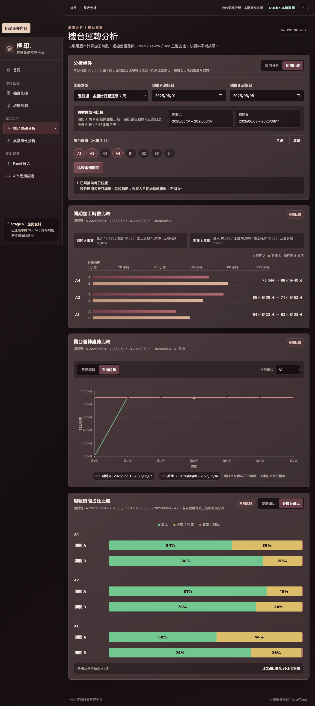

# Stage 5.3 Acceptance — Human UAT Final UI/UX Corrections

Date: 2026-11-15

Branch: `dev`
Implementation commit: `0f329bf`

## Decision

The five authorized UI/UX corrections are complete for implementation, automated regression, public-synthetic browser operation, and 1280/1366/1440px layout verification. Existing statistics, quality eligibility, Excel behavior, API contracts, and SQLite schema were preserved.

Subjective final approval remains the user's visual UAT decision. Enterprise/private-data validation was not performed and is not claimed.

## Results by requested correction

### 1. Solid trend lines

- Range and comparison trend polylines now use solid strokes only.
- Tooltip, keyboard focus, legend-series focus, and independent hide/show behavior remain operational.
- Browser assertion found zero `polyline[stroke-dasharray]` nodes in range and comparison modes.
- The overlap Tooltip still reported all colocated values; legend focus dimmed two non-focused series and hiding one legend did not change the three selected machines.

Evidence: `src/components/history-widgets.tsx`, `tests/stage53-visual-v2.test.tsx`, and `scripts/stage53-browser-acceptance.mjs`.

### 2. Light-state percentage readability

- Percentage labels changed from 9px/light-on-color styling to 16px, weight 900, dark `rgb(33, 17, 22)`, with a subtle light edge.
- Share bars increased to 42px high; machine labels and legend text were also enlarged.
- The browser measured every visible in-bar percentage at 16px, weight 900, and the required dark contrast color.
- Tooltip and accessible row descriptions retain exact decimal percentages and duration values; the bar label remains a rounded visual summary.

Evidence: `src/app/globals.css` and the functional browser runner.

### 3. Multi-day grain

- A single date keeps the 30/60-minute selector.
- Once start and end dates differ, the selector displays `每日（跨日固定）`, is disabled, and the page explains that missing dates remain missing rather than zero.
- The UI-only control model does not change the approved backend behavior: the existing history service remains the source of daily cross-date points.
- Browser verification measured `value=daily`, `disabled=true`, five daily Tooltip zones for 2025/06/01–06/05, and no page/chart overflow at all three target widths.

Evidence: `src/features/history/chart-ui-model.ts`, `src/app/history/processing/page.tsx`, and the browser runner.

### 4. Day/week/month comparison guidance

- Options now state their alignment explicitly: hourly day comparison, seven days from each selected start date, and complete-calendar-month averaging.
- Week inputs are labelled `期間 A 起始日` and `期間 B 起始日`.
- The guidance panel calculates and displays complete ranges before query. For the acceptance input it showed:
  - Period A: 2025/06/01 – 2025/06/07
  - Period B: 2025/06/08 – 2025/06/14
- Day and month inputs likewise preview an exact day or full calendar month. The existing API request shape and comparison formulas were not changed.

Evidence: `comparisonInputRange` unit regression and the real-browser week flow.

### 5. Purpose-based typography audit

Typography was adjusted by component purpose, not by page zoom or `transform: scale`.

| Representative element | Before | After |
|---|---:|---:|
| Sidebar navigation | 13px | 16px (15px below 1200px content breakpoint) |
| Brand title | 22px | 25px |
| Page description | 13px | 16px |
| Panel title / subtitle | 14px / 10px | 20px / 14px |
| Form label / control | 11px / inherited small size | 16px / 16px |
| Button | 11px | 16px |
| Data table body | 11px | 16px |
| Chart legend / axis | 9px / 9px | 14px / 14px |
| Home workspace description | 11px | 16px |
| Selected filename | 11px | 16px |
| Light-state row / percentage | 10px / 9px | 16px / 16px |

The changes cover the shared shell/sidebar/topbar, home, Excel import, machine-operation analysis, event analysis, and the completed deferred-state machine/environment/API pages. Heights, padding, table minimum widths, sidebar/content width, chart rows, form controls, and responsive wrapping were increased with the type. The Excel version table intentionally uses its existing internal horizontal scroll at laptop widths; no page-level horizontal scroll was introduced.

## Before/after DOM audit

The committed `stage53-typography-browser-audit.mjs` runner opened all seven completed routes at browser 100% zoom and 1280/1366/1440px. It measured visible direct-text font sizes, overflow, and unhandled clipping.

At 1366px:

| Page | Visible text below 14px before | After | Page overflow after | Unhandled clipped nodes after |
|---|---:|---:|---|---:|
| Home | 31 | 0 | No | 0 |
| Excel import | 228 | 0 | No | 0 |
| Machine operation | 49 | 0 | No | 0 |
| Event analysis | 52 | 0 | No | 0 |
| Machine monitoring deferred state | 25 | 0 | No | 0 |
| Environment monitoring deferred state | 25 | 0 | No | 0 |
| API settings | 25 | 0 | No | 0 |

The 1280px and 1440px results also had zero visible direct-text nodes below 14px, zero page overflow, and zero unhandled clipped nodes on every route. Remaining 14–15px text is limited to secondary metadata, chart ticks/legends, status chips, and similar subordinate information; primary body, table, form, and action text is 16px or larger.

Raw measurements: `docs/evidence/stage5_3_uat_ux/before/metrics.json` and `docs/evidence/stage5_3_uat_ux/after/metrics.json`.

## Browser acceptance

Environment: local production build, Chrome headless at 100% zoom, localhost only, and the existing public synthetic Stage 5.3 SQLite fixture under `/private/tmp`. No enterprise endpoint or real product database was used.

Functional results:

- Range 30/60-minute modes preserved totals and shares while changing 48 to 24 time positions.
- Tooltip, overlapping series readout, legend focus/hide, valid zero, and missing-machine states passed.
- Multi-day mode forced daily grain and rendered exactly five positions.
- Day comparison, single-machine local mode, per-machine shares, seven-day comparison, and 28/31-day month comparison passed.
- Range and comparison layouts at 1280/1366/1440px all measured `scrollWidth === clientWidth`; chart containers did not overflow.
- The percentage contrast, solid line, daily lock, and week-range checks are executable assertions that stop the browser runner on regression.

Key screenshots:

### Range with Tooltip and readable percentages

### Multi-day forced daily grain

### Week comparison with calculated date ranges

Before/after screenshots for home, import, machine-operation, event, machine-monitoring, environment-monitoring, and API-settings routes are under `docs/evidence/stage5_3_uat_ux/before/` and `after/`. Home/import/operation also have 1280 and 1440 captures.

## Automated verification

| Command | Result |
|---|---|
| `npm run typecheck` | Passed |
| `npm run lint` | Passed with no warnings |
| `npm test -- --run` | Passed: 98; skipped: 1 opt-in private-workbook test |
| `npm run build` | Passed with the approved `next build --webpack`; 18 pages/routes generated |
| `node scripts/stage53-browser-acceptance.mjs` | Passed all operational and new UAT assertions |
| typography browser audit | Passed before/after capture and three-width DOM measurement |
| `git diff --check` | Passed |
| changed-file sensitive-pattern scan | Passed |

## Safety and acceptance boundary

- No Excel parser/import behavior, quality eligibility, statistical formula, API response contract, or SQLite schema changed.
- No enterprise API, private workbook/JSON, credential, environment file, database, or `_reference_inputs` attachment was accessed or committed.
- No real database or Docker volume was modified/deleted.
- No push, deployment, Stage 6, or Stage 7 work occurred.
- A final subjective visual review by the user is still recommended for personal reading preference, but no known functional or responsive blocker remains in this authorized scope.
