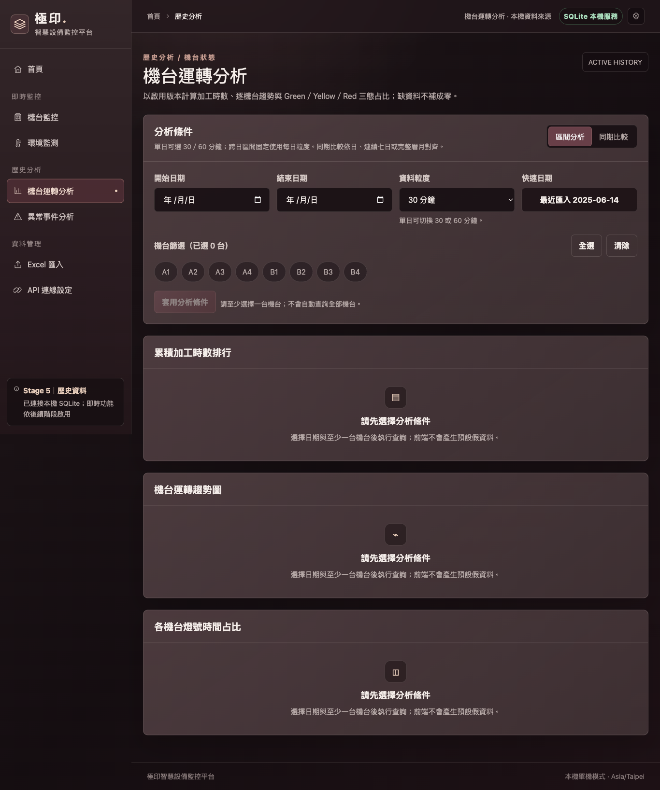
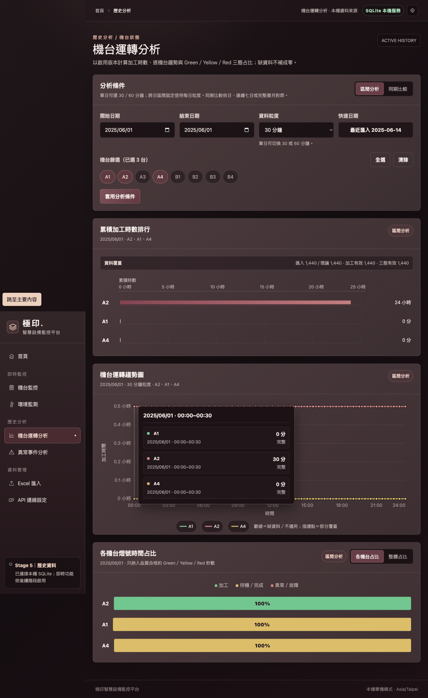
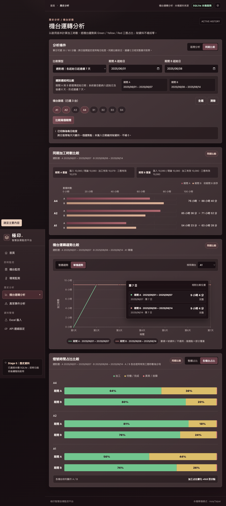
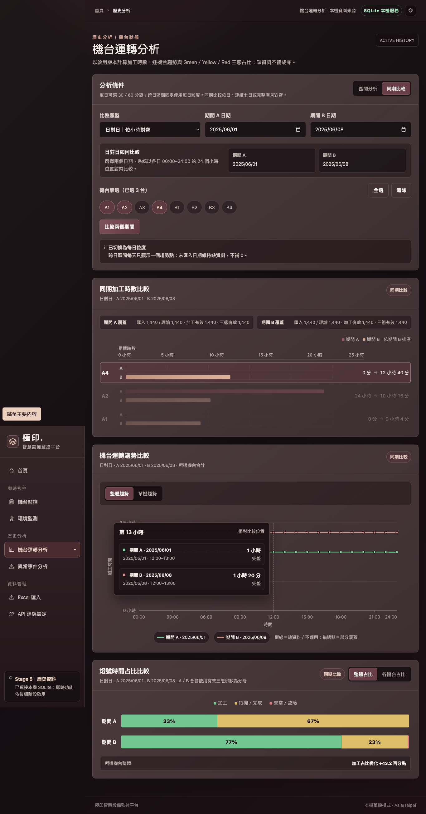
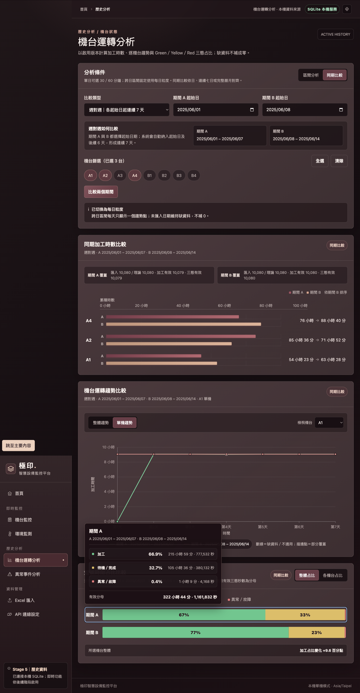

# Stage 5.3｜人工 UAT 視覺補修 Round 2 驗收

日期：2026-11-15  
分支：`dev`  
實作 Commit：`56a8782`

## 驗收結論

本輪六項局部 UI／圖表問題已完成程式修正、自動回歸與公開合成資料的真實瀏覽器驗收，可以交付人工 UAT。統計公式、比較規則、資料品質、SQLite Schema、Excel 匯入及其他頁面均未修改。

本文件所列瀏覽器結果來自隔離的 `/private/tmp` 合成 SQLite 與 production build，不含企業資料；人工對實際業務資料的主觀視覺確認仍不宣稱完成。

## 六項問題、根因與修正

| 項目 | 根本原因 | 修正與程式證據 | 驗收結果 |
|---|---|---|---|
| 1. 分析條件對齊 | 原 `.filters` 以內容底部對齊，只有資料粒度有說明列，使整個欄位堆疊向上偏移。 | `src/app/history/processing/page.tsx` 將四欄統一為 label／control／help 三列；`src/app/globals.css` 以 Grid 管理列高，空白說明列保留版位，控制項統一 50px。 | 四欄 label、control top/bottom、height 的 spread 均為 `0px`。 |
| 2. 趨勢圖 Y 軸重疊 | SVG 繪圖左界僅 72，軸標題位於 x=16，動態刻度文字會進入標題區。 | `src/components/history-widgets.tsx` 將繪圖左界調為 108、標題置於 x=20，保留動態刻度與繪圖寬度。 | 單日 30／60 分鐘、多日、日／週／月比較六種模式均無重疊；標題與刻度最小間距 `23.1px`。 |
| 3. 機台名稱與圖條距離 | 每列固定保留 135px 標籤欄，短機台代碼產生大量空白。 | `src/app/globals.css` 改為 `max-content` 標籤欄加 16px gap，圖條取得釋出的可用寬度。 | A1／A2／A4 的實測間距均為 `16px`；1366px 圖條寬約 948–951px。 |
| 4. 比較折線最後一點變形 | `PARTIAL` 點使用較大半徑與虛線描邊；位於邊界時外觀像拉伸／裁切，焦點狀態更明顯。 | 所有點統一 `r=3.8`；部分覆蓋改為同尺寸實線描邊。透明鍵盤互動區不再顯示瀏覽器原生矩形 outline，既有 crosshair、Tooltip 與點描邊仍提供焦點回饋。 | A/B 首尾點於 normal／focus 皆約 `7.63 × 7.63px`、`stroke-dasharray: none`，保持圓形。 |
| 5. 比較趨勢 Tooltip | 通用四欄 Tooltip 寬度不足，日期、A/B 數值與狀態互相擠壓；末端定位條件亦不完整。 | Tooltip 改為標題加 A/B 獨立資訊列，日期禁止任意拆分，數值與品質狀態分層；桌面寬 500px，依資料點位於左／右側翻轉。 | 日／週／月皆為兩列，日期未溢位；1366px 實測 `500 × 232.5px` 且完全位於 viewport。 |
| 6. 比較燈號 Tooltip | 舊 Tooltip 絕對定位於圖卡內且過窄，內容多時擁擠，靠近視窗上下緣可能被裁切。 | 新增共用 `FloatingTooltip`，依 anchor、viewport 與 scroll 即時計算 fixed 位置；內容改為期間標題、三態列與有效分母，桌面寬 520px，可在上／下方與左右邊界自動調整。 | 整體與各機台 Tooltip 均有三態列；1366px 實測 `520 × 307px`，1280／1366／1440px 全部在 viewport 內且無水平溢位。 |

## 自動測試與建置

| 命令 | 實際結果 |
|---|---|
| `npm run typecheck` | 通過 |
| `npm run lint` | 通過，無 warning |
| `npm test -- --run` | 通過：98 tests passed；1 個需私人 workbook 的 opt-in suite skipped |
| `npm run build` | 通過：Next.js 16.4.6、專案既定 Webpack production build、18 routes |
| `git diff --check` | 通過 |

`tests/stage53-visual-v2.test.tsx` 新增部分覆蓋點與 SVG 幾何回歸：確認 Y 軸左界、標題位置、統一資料點半徑與不再使用 4.8px 異形點。`scripts/stage53-browser-acceptance.mjs` 新增六項問題的 DOM 幾何、Tooltip viewport、首尾點 focus 與響應式斷言。

## 真實瀏覽器與 DOM 驗收

環境：本機 production build、Chrome desktop、100% 縮放、`127.0.0.1:3001`、隔離合成 SQLite。完整量測原始值保存於 `evidence/stage5_3_uat_round2/metrics.json`。

| 驗收範圍 | 結果 |
|---|---|
| 區間單日 30／60 分鐘 | 通過；控制項對齊、Y 軸無重疊、Tooltip 正常 |
| 區間多日 | 通過；每日粒度、Y 軸無重疊、各機台圖條 16px label gap |
| 同期日／週／月 | 通過；Y 軸無重疊、首尾點正常、兩列 Tooltip 日期不拆分 |
| 比較整體／各機台燈號 | 通過；三態、時間、秒數、分母完整，邊界不裁切 |
| 1280／1366／1440px | 通過；range 與 comparison 的 `scrollWidth === clientWidth`，所有圖卡及兩類 Tooltip 無水平溢位 |

### 1. 篩選欄位對齊

### 2. Y 軸間距與 3. 機台標籤距離

### 4. 比較折線最後資料點

### 5. 比較趨勢 Tooltip

另有週、月證據：

- `evidence/stage5_3_uat_round2/05-comparison-trend-tooltip-week-fixed-1366.png`
- `evidence/stage5_3_uat_round2/05-comparison-trend-tooltip-month-fixed-1366.png`

### 6. 比較燈號 Tooltip

各機台證據：`evidence/stage5_3_uat_round2/06-comparison-share-tooltip-machine-fixed-1366.png`。

## 安全與範圍確認

- 六張原始錯誤截圖只在被忽略的 `_reference_inputs/` 唯讀檢視，未加入 Git。
- 已提交證據只使用公開合成資料；未存取企業 API、私人 Excel、真實資料庫、憑證或環境檔。
- 未修改統計值、資料精度、資料品質資格、比較規則、SQLite、Excel 匯入或異常事件頁。
- 未 Push、部署、開始 Stage 6／7、刪除資料／Volume 或執行破壞性 Git 操作。

## 尚待人工確認

- 使用者依六張原始 UAT 截圖進行最終主觀視覺確認。
- 真實業務資料的畫面內容未在本輪重跑；本輪只宣稱公開合成資料與程式層驗收完成。

完成本輪後停止，等待人工 UAT。
